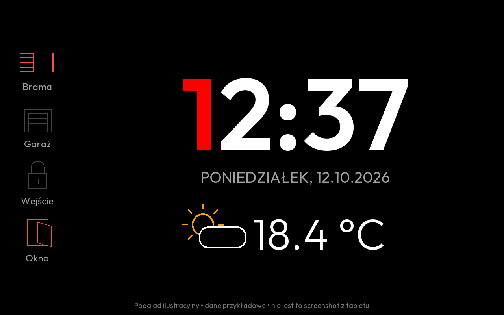
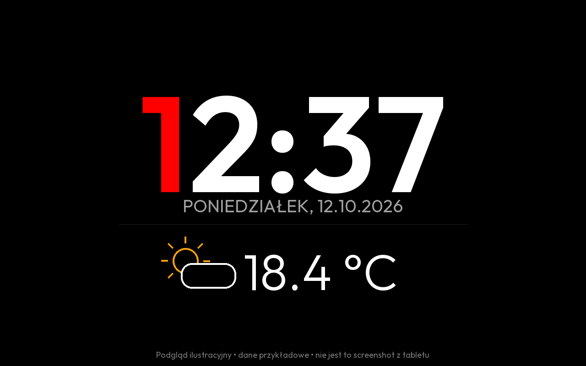

# Zegar HA Outfit — KioskSatellite

Wygaszacz KioskSatellite SDK 1: zegar HH:mm i polska data (Europe/Warsaw), temperatura HA i lokalne animowane ikony pogody. Czcionka Outfit (300/400/600) jest w paczce. HTML nie pobiera nic z internetu i nie zawiera tokenu HA.

Dokumentacja: [historia zmian](CHANGELOG.md), [wydanie 1.7.1](docs/RELEASE-1.7.1.md), [współtworzenie](CONTRIBUTING.md).

## Podgląd

Ilustracje przedstawiają przykładowy układ; nie są screenshotami z tabletu. Rzeczywisty rozmiar zależy od rozdzielczości ekranu i ustawień.





[Pełna instrukcja instalacji i konfiguracji](docs/CONFIGURATION.md) opisuje wszystkie ustawienia, stany encji, konfigurator oraz ograniczenia.

## Instalacja

1. W KioskSatellite lub Remote Admin: **Plugin Manager → Developer Tools → Install from ZIP**, wybierz `dist/ha-outfit-clock-1.7.1.zip`. Istniejącą lokalną instalację aktualizuj tym ZIP bez odinstalowywania; ustawienia i wybór trybu pozostają zachowane.
2. Włącz **Zegar HA Outfit** i główny przełącznik pluginów.
3. W ustawieniach pluginu wybierz encje temperatury, pogody i słońca. Domyślne ID są przykładami — wybierz własne encje. Każdy tablet może mieć własne ustawienia.
4. **Screensaver → Screensaver mode → Zegar i pogoda (Zegar HA Outfit)**. Dostępny także w harmonogramie.
5. W Androidzie włącz automatyczną datę i godzinę. W KioskSatellite włącz **pixel shift**; plugin nie dodaje drugiego przesuwania.

Połączenie HA musi być skonfigurowane w KioskSatellite. Plugin korzysta z oficjalnego SDK i autoryzacji aplikacji, bez osobnego tokenu.

## Ustawienia

Wybór encji, 0 lub 1 miejsce po przecinku, osobne skale zegara/daty/temperatury/ikony (50–200%), kolory zegara/daty/temperatury/tła i jedynek w godzinach. Wyróżnianie jedynek można wyłączyć. Ikony zachowują oryginalne kolory. Temperatura może pochodzić z sensora lub `weather.*` (atrybut temperature); jednostka pochodzi z encji. Bez encji słońca stan clear-night wybiera noc, pozostałe wariant dzienny.

Całość automatycznie zmniejsza się, jeśli nie mieści się na ekranie, także w poziomie i obok Now Playing. Skale są względne do oryginalnego układu; długa data może ograniczyć maksymalny rozmiar zegara.

## Działanie i ograniczenia

Od wersji 1.7.1 opcja **Pokaż cały pasek, gdy co najmniej jedna encja jest aktywna** pokazuje wszystkie skonfigurowane pozycje, również nieaktywne, jeśli choć jedna jest aktywna, alarmowa lub w ruchu. Gdy żadna nie jest aktywna, cały pasek znika, a zegar zajmuje pełną szerokość. Dotychczasowe ustawienie trybu z wersji 1.7.0 działa bez zmiany. Aktualizacje HA nadal są scalane do około 15 sekund.

Od wersji 1.6.1 przełącznik **Pokaż ikony informacyjne** w konfiguratorze ukrywa cały pasek bez usuwania encji i wyglądu ikon. Wczytaj obecne ustawienia, odznacz przełącznik i wklej wynik do pluginu. Ponowne zaznaczenie przywraca ikony. Zapis ukrycia: prefiks icons=off; przed layout=...;. Bez ikon zegar i pogoda zajmują pełną szerokość.

### Własny zestaw ikon (1.6.0)

W każdej karcie konfiguratora lista **Własne delikatne ikony** oferuje bramę przesuwną w lewo, bramę garażową, okno i zamek. Po wczytaniu obecnych ustawień wybierz ikonę dla odpowiedniej pozycji i wklej wygenerowany wynik do pluginu. Encje pozostają zapisane osobno. Podgląd pokazuje wariant aktywny i nieaktywny. Identyfikatory: `custom:gate-left`, `custom:garage`, `custom:window`, `custom:lock`.

Garaż otwarty ma uniesione panele, okno otwarte ma odchylone skrzydło, a zamek odryglowany rozpięty pałąk. HA `open`/`on` wybiera wariant otwarty, `closed`/`off` zamknięty. Dla zamka `locked` oznacza zaryglowany, `unlocked` odryglowany; nie oznacza to potwierdzenia otwarcia drzwi. Podczas ruchu używany jest wariant aktywny. `jammed` pokazuje ikonę zastępczą w kolorze aktywnym, a brak danych szary znak zapytania. Domyślny kolor nieaktywny to grafitowy `#444444`; zapisane własne kolory są zachowane.

Źródłem geometrii jest `resources/custom-icons.json`, wspólne dla pluginu i konfiguratora. Zestaw działa lokalnie i nie wymaga pobierania ikon z sieci.

### Własna brama przesuwna (1.5.0)

W konfiguratorze przy pozycji bramy kliknij **Brama przesuwna w lewo — własna**, następnie skopiuj ustawienia do pluginu. Identyfikator `custom:gate-left` wybiera zatwierdzony kontur z poziomymi przęsłami i grubszym prawym słupkiem. HA `open`/`on` pokazuje odsunięte w lewo skrzydło, `closed`/`off` pełne zamknięte skrzydło. Dla binary_sensor `on` musi oznaczać otwarcie. Podczas `opening`/`closing` używany jest wariant otwarty; brak danych pokazuje znak zapytania. Kolory i rozmiary pozostają konfigurowalne. Zmiany HA nadal są scalane do około 15 sekund. Konfigurator pokazuje obok siebie wariant otwarty i zamknięty.

### Pięć ikon informacyjnych (1.4.0)

W konfiguratorze wybierz **Położenie ikon → Po lewej — pionowo** lub **Na dole — w rzędzie**, następnie skopiuj wynik do pluginu. Lewy pasek dopasowuje szerokość do ikon i podpisów; długie nazwy zawijają się przy 18% szerokości ekranu. Zegar i pogoda są wyśrodkowane w pozostałej części. Bez wybranych encji pasek nie zajmuje miejsca. Nowa instalacja domyślnie używa układu lewego; aktualizacja zachowuje dotychczasowy dolny rząd do zmiany ustawień. Układ jest zapisany jako prefiks `layout=left;` albo `layout=bottom;` przed pięcioma pozycjami; dotychczasowy format bez prefiksu nadal działa.

Na ekranie są tylko ikona i nazwa, bez podpisów Włączone/Wyłączone. Kolory aktywnego i nieaktywnego stanu są konfigurowalne osobno dla każdej pozycji. Ruch i problem mają kolor aktywny. Brak danych to szary znak zapytania. Nazwa pozostaje w kolorze daty, a zmiana stanu zmienia kolor ikony.

Otwórz **konfigurator-ikon.html** w przeglądarce: formularz działa offline, ma pięć kart, pola nazw, suwaki rozmiaru, wybór ikony z podglądem i palety kolorów. Wczytaj obecną wartość pola infoLayout, jeśli chcesz zachować nazwy, następnie skopiuj wynik do **Nazwy, ikony i wygląd pięciu pozycji** w KS. Encje nadal wybierasz w pluginie. Formularz nie łączy się z HA ani KS i nie zapisuje ustawień sam: wklejenie wyniku jest wymagane z powodu limitu 20 ustawień i braku własnego interaktywnego panelu w SDK.

Ikona wybierana jest kolejno: ręczny wybór, atrybut `icon` encji HA (`mdi:...`), rozpoznanie domeny i device_class, neutralna ikona ogólna. Zestaw MDI 7.4.47 i aliasy są w pluginie lokalnie; tylko pięć wybranych ścieżek trafia do HTML. Ikona ustawiona wyłącznie w karcie dashboardu HA nie jest atrybutem encji i nie jest dostępna w SDK. W takim przypadku wskaż ją ręcznie w formularzu. Custom icon packs oraz URL obrazków nie są obsługiwane.

W grupie **Ikony informacyjne** wybierz do pięciu encji. Puste pozycje znikają. Zamki pokazują zaryglowanie/odryglowanie, bramy otwarcie/zamknięcie/ruch, a binary_sensor z device_class door/window/opening/garage_door otwarcie. Inne encje pokazują swój stan i ikonę ogólną. Odryglowanie nie oznacza otwarcia drzwi. Brak połączenia lub nieznany stan pokazuje znak zapytania zamiast ostatniego stanu zamka.

SDK ma limit 20 ustawień: pięć wyborów encji jest osobnych, natomiast nazwy i rozmiary są we wspólnym polu **Nazwy i rozmiary pięciu pozycji**. Kolejne pozycje oddziela średnik; każda ma format 
azwa|rozmiar ikony %|rozmiar podpisu %`, np. `Brama|120|100;Drzwi wejściowe|100|80;Garaż|100|100`. Zakres 50–200%, brak rozmiaru oznacza 100%. Pusta nazwa używa friendly_name z HA. Kolejność fragmentów odpowiada numerom pozycji, także jeśli część encji jest pusta. Nie używaj średnika ani pionowej kreski w nazwach.

Domyślnie zamknięte/zaryglowane/wyłączone są szare, aktywne/otwarte/odryglowane czerwone. Ikony nie sterują urządzeniami. Aktualizacje są scalane do około 15 sekund.

Plugin subskrybuje dane także podczas wyświetlania dashboardu. Zegar przelicza aktualny czas co sekundę i po wznowieniu; Europe/Warsaw uwzględnia czas letni/zimowy. Pogoda zachowuje logikę oryginału: cloudy i cloud_coverage >80% daje overcast; partlycloudy w nocy wybiera partlycloudy-night2.

Od wersji 1.1.0 plugin używa `publishScreensaver` i osadza HTML, JS, czcionkę oraz SVG w jednym dokumencie (około 321 KB, poniżej limitu 512 KiB). Nie korzysta już z `publishScreensaverAsset`, którego zmiana danych odtwarzała WebView. W sprawdzonym kodzie KioskSatellite aktualizacja inline ładuje nowy dokument w ukrytej ramce i zachowuje poprzedni obraz do momentu jej przygotowania. Nie jest to aktualizacja pojedynczego pola DOM: ramka i animacje są wymieniane, ale zewnętrzny WebView pozostaje ten sam. Wymaga to wersji KS z obsługą aktualizacji inline; skuteczność na zainstalowanej wersji wymaga testu tabletu.

Plugin pomija niewidoczne zmiany i scala aktualizacje; publikacje danych HA dzieli co najmniej 15 sekund. Zmiana ustawień stosowana jest natychmiast. Po uruchomieniu pluginu widoczne mogą być kreski do nadejścia pierwszych odczytów (do około 15 sekund po publikacji początkowej, plus czas połączenia HA). Późniejsze wejścia korzystają z już odebranych danych.

Ostatnie poprawne wartości zachowywane są w pamięci sesji i oznaczane jako nieaktualne po utracie dostępności. Brak pierwszego odczytu to kreska i znak zapytania. Dane nie są zachowywane po restarcie. Całkowity brak błysku wymaga sprawdzenia na urządzeniu; czarne tło najlepiej pasuje do tła uruchamianego WebView.

Minimalny Android: API 24 (Android 7). Wymagana jest aplikacja KioskSatellite z obsługą pluginów SDK 1 i aktualizacji wygaszacza inline. Użytkownik sprawdził plugin na tabletach. Biały błysk został usunięty w osobnym diagnostycznym APK KioskSatellite opartym na wydaniu 2026.10.15 (313); poprawka ustawień WebView należy do aplikacji hosta i nie jest zawarta w ZIP pluginu. Nie deklarujemy zgodności każdej wersji aplikacji ani wszystkich urządzeń.

## Budowanie i publikacja

Oficjalna ścieżka: Python 3, JDK 17+, Android SDK platform 35 i build-tools 35.0.0; ustaw JAVA_HOME i ANDROID_HOME:

```sh
python tools/test-clock.py
node tools/test-renderer.cjs
python tools/build.py --android-platform 35
```

Przenośna ścieżka dla tego pluginu bez Android API: JAVA_HOME wskazuje JDK 17+, R8_JAR oficjalny Google r8.jar; uruchom `python tools/build-local.py`. D8 tworzy DEX z minimalnym API 24. Wydania GitHub używają oficjalnej ścieżki Android SDK. Testy i oba buildery uruchamiają `tools/embed-renderer.py`, który generuje `InlineRenderer.java` z plików `assets/clock`. Edytuj źródła w assets, a nie wygenerowany plik Java.

Workflow `.github/workflows/build.yml` buduje tag wydania i publikuje manifest, ZIP i SHA-256. KS wymaga publikacji przez GitHub Actions dla instalacji repozytoryjnej. Sposób instalacji repozytoryjnej zależy od obsługi przez aplikację i poprawnie zakończonego wydania GitHub Actions.

## Licencje

Kod i interfejsy/narzędzia SDK: Apache-2.0 (LICENSE). Outfit: SIL Open Font License (`assets/clock/fonts/OFL.txt`). Material Design Icons: Pictogrammers/Templarian, Apache-2.0, licencja w `assets/clock/MDI-LICENSE.txt`. Źródła katalogu: repozytoria Templarian/MaterialDesign i Templarian/MaterialDesign-JS; lokalny znormalizowany katalog w resources/mdi/paths.tsv.gz. Ikony pogody dostarczył użytkownik z własnego dashboardu; ich licencja nie została określona. Przed publikacją publiczną należy ustalić prawa do ich dystrybucji.

SDK: https://github.com/jxlarrea/kiosk-satellite-plugin-hello-world


